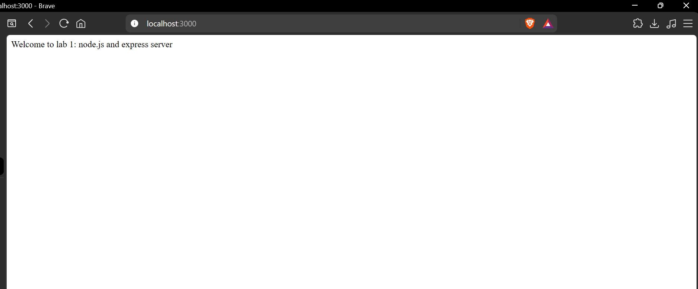
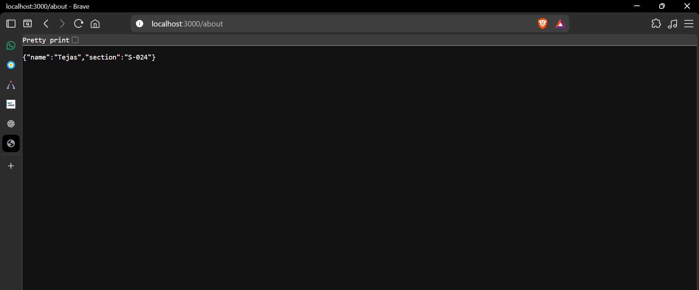
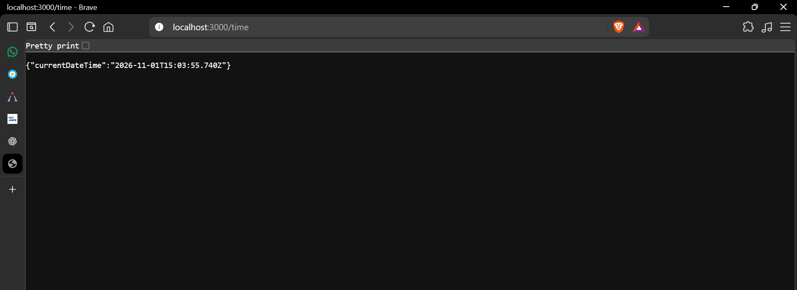
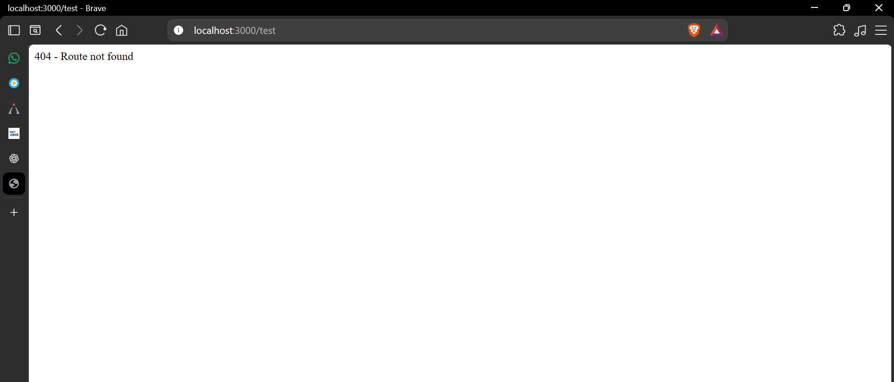

Name: Tejas Kataram
Registration number: 252U1R9064 
Section: Gen -AI 2A 304 S-024


```bash
npm install
npm start
```

The server will run at:

```text
http://localhost:3000
```


| Method | Path | Description |
|---|---|---|
| GET | `/` | Returns the welcome text |
| GET | `/about` | Returns name and section as JSON |
| GET | `/time` | Returns the current date and time |
| GET | Any unknown path | Returns a 404 message |


## Screenshots

### Home route


### About route


### Time route


### 404 route



Replace the placeholder name, registration number, and section before submission.

## Viva preparation

- `package.json` stores project metadata, scripts, and dependencies. `node_modules` contains the installed packages.
- `app.listen()` starts the Express server and makes it listen for incoming requests on the specified port.
- `req` represents the incoming request, while `res` represents the response sent back to the client.
